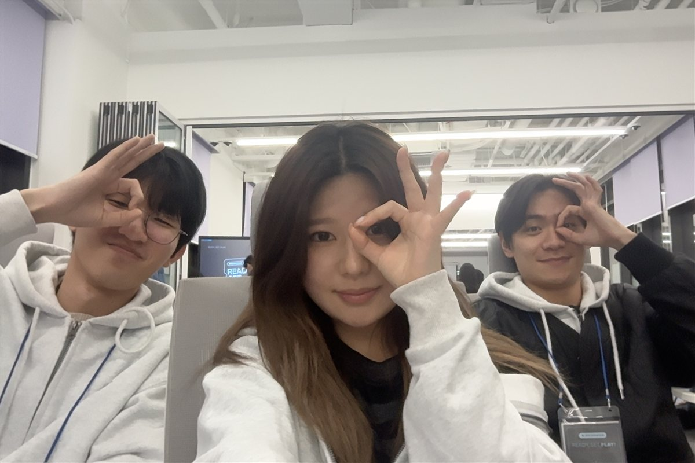
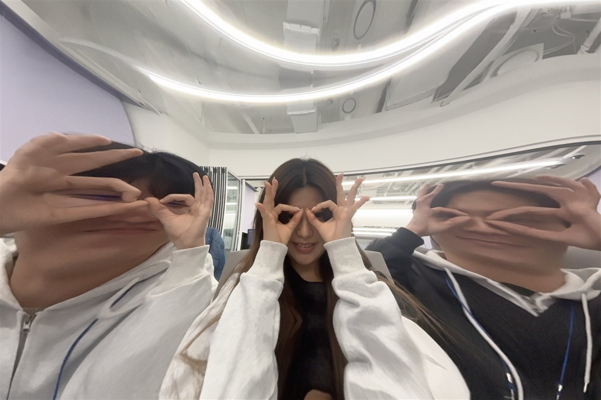
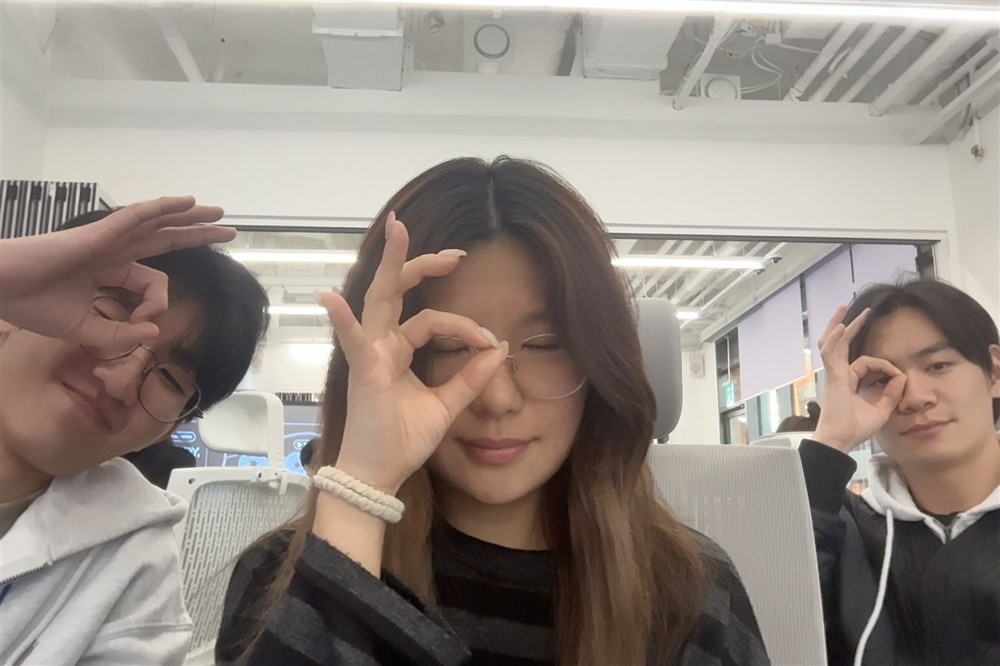
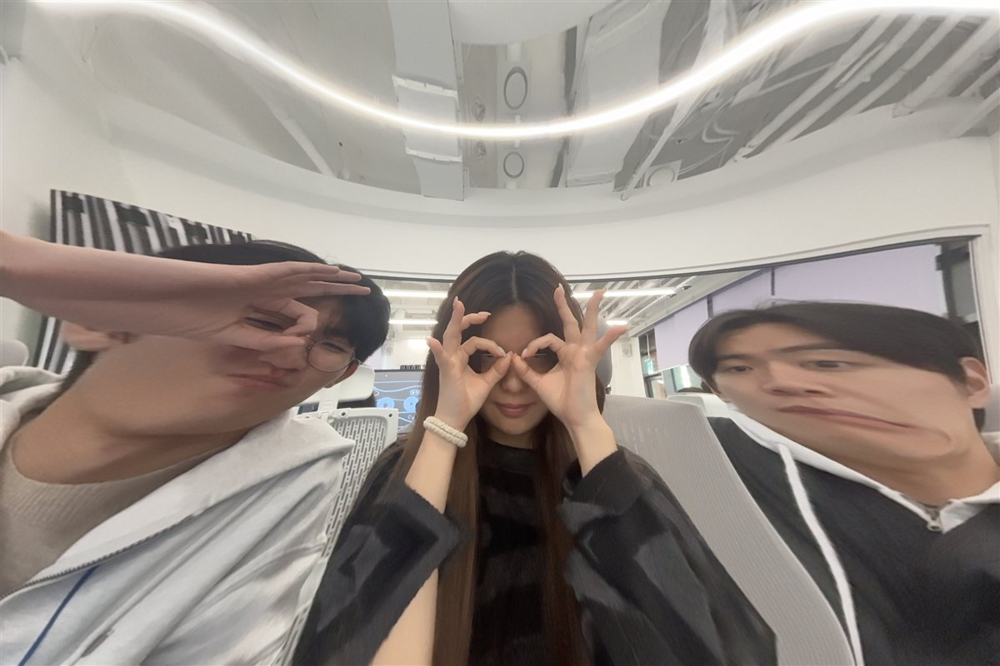

<div align="center">

<h2>오작교</h2>

<p><strong>67세 순자 씨, 동네 오빠한테 번호 받았습니다.</strong></p>
<p>
65세 이상 어르신이 사진 한 장과 전화번호로 근처 사람에게 '번호 주기'를 하고,<br />
통화한 뒤에는 동네 제휴 가게에서 만나도록 잇는 모바일 웹 데이팅 서비스예요.
</p>

<p>
  <a href="https://39-sopkathon-web-web2.vercel.app"><strong>오작교 바로 가기</strong></a>
  ·
  <a href="https://39-sopkathon-web-web2.vercel.app/owner"><strong>사장님용 페이지 바로 가기</strong></a>
</p>

</div>

| 누가 쓰나요       | 주소                                             | 화면                                |
| ----------------- | ------------------------------------------------ | ----------------------------------- |
| 어르신 (주 타겟)  | https://39-sopkathon-web-web2.vercel.app         | 모바일 웹. 휴대폰으로 열어 주세요   |
| 사장님 (부 타겟)  | https://39-sopkathon-web-web2.vercel.app/owner   | 제휴 가게 소개 · 신청 페이지        |

| 타겟    | 연령      | 누구에게 어떤 도움이 되나요                                                                |
| ------- | --------- | ------------------------------------------------------------------------------------------ |
| 주 타겟 | 65세 이상 | 동네 콜라텍에 다니며 곁에 짝 없이 지내는 어르신이 긴 가입 없이 전화 한 통으로 사람을 만나요 |
| 부 타겟 | 30·40대   | 동네에서 카페·식당을 하는 사장님에게 통화를 마친 어르신들이 새 손님으로 찾아와요           |

## ✨ 오작교 주요 기능

### 1️⃣ 전화번호 하나로 입장

**전화번호**만 넣으면 바로 들어와요. 아이디와 비밀번호가 없어요. 번호는 `010-1234-5678`처럼 읽기 쉽게 보여 줘요.

처음이면 한 화면에서 사진, 이름, 성별, 태어난 년도를 넣어요. 태어난 년도는 큰 글씨로 굴려서 고르고, "시작하기"를 누르면 내 위치를 받아요.

### 2️⃣ 근처 사람 넘겨 보기

**가까운 순**으로 한 명씩 보여 줘요. 카드에는 사진, 이름, 나이, 나와의 거리만 있어요. 손으로 미는 동작 대신 큰 "다음 사람 보기" 버튼으로 넘겨요.

### 3️⃣ 쪽지와 함께 번호 주기

마음에 드는 사람에게 **짧은 쪽지**(50자)와 함께 내 번호를 보내요. 쪽지는 안 써도 돼요.

### 4️⃣ 받은 쪽지와 전화 걸기

쪽지가 오면 하단 **받은쪽지 탭에 빨간 점**이 떠요. 받은 사람은 보낸 사람의 사진과 쪽지를 보고, "전화 걸기"를 눌러 바로 통화해요. 통화를 마친 사람은 "이어진 사랑"으로 옮겨져요.

### 5️⃣ 통화 후 안심장소

**통화를 마치면** 동네 제휴 장소 목록으로 이어져요. 장소마다 사진, 이름, 주소, 거리와 제휴 혜택을 보여 주고, "지도보기"로 네이버 지도를 열어요.

### 6️⃣ 사장님용 페이지

동네 사장님에게 오작교를 소개하고 제휴를 신청받는 **데스크톱 페이지**예요. 통화를 마친 어르신들이 제휴 가게를 찾아가는 흐름을 보여 줘요.

## 👥 Team

<table align="center">
  <tr align="center">
    <td>
      <a href="https://github.com/KimJongHyun2">
        
        <br />
        <b>KimJongHyun2</b>
      </a>
    </td>
    <td>
      <a href="https://github.com/bosung0505">
        
        <br />
        <b>bosung0505</b>
      </a>
    </td>
    <td>
      <a href="https://github.com/hycho04">
        
        <br />
        <b>hycho04</b>
      </a>
    </td>
  </tr>
  <tr align="center">
    <td>김종현</td>
    <td>이보성</td>
    <td>조현영</td>
  </tr>
  <tr align="center">
    <td>
      전화번호 입장 · 온보딩 · 안심장소 페이지<br />
      로그인 · 온보딩 · 안심장소 API 연동<br />
      새 쪽지 알림, 화면 틀, 입력창 컴포넌트<br />
      초기 세팅, 배포, CI, 디스코드 알림 봇
    </td>
    <td>
      매칭 · 쪽지 작성 페이지<br />
      매칭 조회 · 넘기기 · 번호 주기 API 연동<br />
      아이콘, 버튼 · 상단 바 컴포넌트<br />
      PR 자동 코드 리뷰 설정
    </td>
    <td>
      받은 쪽지 · 상세 프로필 페이지<br />
      받은 쪽지 조회 · 통화 완료 API 연동<br />
      사장님용 데스크톱 웹 페이지 구현<br />
      내비게이션 바 · 모달 컴포넌트<br />
      이슈 폼, 브랜치 자동 생성, 자동 라벨링
    </td>
  </tr>
</table>

## 🛠 기술스택

| 분류          | 기술                                     |
| ------------- | ---------------------------------------- |
| UI · 언어     | React 19, TypeScript                     |
| 빌드          | Vite                                     |
| 패키지 매니저 | pnpm                                     |
| 라우팅        | React Router                             |
| 네트워크      | Axios                                    |
| 스타일        | Tailwind CSS v4                          |
| 애니메이션    | Lottie (lottie-react)                    |
| 린트 · 포맷   | ESLint, Prettier                         |
| 배포          | Vercel, GitHub Actions                   |

## 📄 컨벤션 및 브랜치 전략

자세한 규칙은 [AGENTS.md](./AGENTS.md)에 있어요.

### 커밋 컨벤션

| 타입    | 용도                     |
| ------- | ------------------------ |
| `init`  | 초기 세팅                |
| `feat`  | 기능 추가                |
| `fix`   | 버그 수정                |
| `chore` | 설정, 패키지, CI 등 기타 |
| `docs`  | README 같은 문서         |

### 브랜치

| 브랜치                  | 용도                                               |
| ----------------------- | -------------------------------------------------- |
| `main`                  | 배포 브랜치. 머지되면 자동으로 배포돼요            |
| `develop`               | 통합 브랜치(기본 브랜치). 작업 브랜치를 여기로 모아요 |
| `타입/기능명/#이슈번호` | 작업 브랜치. 이슈에 담당자를 지정하면 자동으로 만들어져요 |

- 순서: 이슈 생성 → 담당자 지정 → 브랜치 자동 생성 → 커밋 → `develop`으로 PR → 머지
- `main`과 `develop`에는 직접 push하지 않아요. `main`에는 `develop`에서 올리는 릴리즈 PR로만 반영해요.

### 이름 규칙

| 어디에      | 형식                    | 예시                        |
| ----------- | ----------------------- | --------------------------- |
| 이슈 제목   | `[타입] 내용`           | `[Feat] 로그인 페이지 구현` |
| 브랜치      | `타입/기능명/#이슈번호` | `feat/login-page/#12`       |
| PR 제목     | `타입: 내용`            | `feat: 로그인 페이지 구현`  |
| 커밋 메시지 | `타입: 내용`            | `feat: 로그인 폼 추가`      |

### 코드 컨벤션

- 폴더 · 파일명은 kebab-case, 컴포넌트 · 타입은 PascalCase, 변수 · 함수는 camelCase, 상수는 `UPPER_SNAKE_CASE`
- 컴포넌트는 화살표 함수 + `default export`, 커스텀 훅 · 유틸 · 상수는 `named export`
- 이벤트 핸들러는 `handle~`, Props로 넘길 때는 `on~`, Props 타입은 `~Props`
- import는 `../` 대신 `@/` 절대 경로
- 색상과 폰트는 `global.css`의 `@theme` 토큰만 사용

## 📁 프로젝트 구조

```
src
├── app                 # 앱 진입점 (main.tsx, App.tsx)
├── pages               # 페이지별 폴더
│   ├── login           # 전화번호 입장
│   ├── onboarding      # 온보딩
│   ├── matching        # 매칭
│   ├── message         # 쪽지 작성
│   ├── request         # 받은 쪽지
│   ├── profile         # 상세 프로필
│   ├── place           # 안심장소
│   └── owner           # 사장님용 페이지
│       ├── owner-page.tsx
│       ├── components  # 이 페이지에서만 쓰는 컴포넌트
│       ├── api         # 이 페이지에서만 쓰는 API 함수와 타입
│       └── hooks       # 이 페이지에서만 쓰는 훅
├── routes              # 라우터
└── shared
    ├── api             # axios 인스턴스, 여러 페이지에서 쓰는 API 함수
    ├── assets
    │   ├── icons       # ic-이름.svg
    │   ├── images      # img-이름.png
    │   └── lotties     # lottie-이름.json
    ├── components      # 공통 컴포넌트
    ├── constants       # ROUTES 등
    ├── hooks
    ├── styles          # global.css
    ├── types
    └── utils           # cn 등
```

한 페이지에서만 쓰면 `pages/페이지명/` 안에 두고, 두 페이지 이상에서 쓰면 `shared/`로 올려요.

## 🫶 우리 조 그라운드 룰

- **규칙 1** 모르는 건 삼키지 말고 바로 물어보기. 모르는 게 당연한 거!
- **규칙 2** 막히면 혼자 붙잡지 말고 바로 같이 고민하기
- **규칙 3** 말은 둥글게. 예민하고 피곤해도 서로 배려하기
- **규칙 4** 변경되는 사항은 빠르게 모두에게 공유하기
- **규칙 5** 타 파트와 이어지는 작업은 빠르게 끝내서 넘겨주기

## 🌰 웹토리팟 Before and After

### Before

<p align="center">
  
  
  
</p>

### After

<p align="center">
  
  
  
</p>
